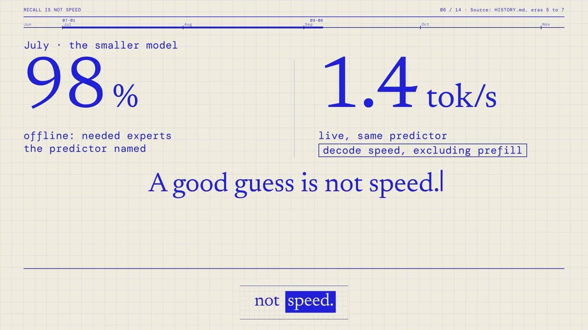

<div align="center">
  <picture>
    <source media="(prefers-color-scheme: dark)" srcset="https://raw.githubusercontent.com/FlashML-org/FreeToken/main/assets/freetoken-logo-dark.svg">
    <source media="(prefers-color-scheme: light)" srcset="https://raw.githubusercontent.com/FlashML-org/FreeToken/main/assets/freetoken-logo-light.svg">
    
  </picture>
</div>

<p align="center">
| <a href="https://www.flashml.ai/"><b>Download</b></a> | <a href="https://arxiv.org/abs/2608.16157"><b>Paper</b></a> | <a href="https://join.slack.com/t/flashml/shared_invite/zt-3zpdh5j10-9dwTXrgLiqpVxizhA9KVbA"><b>Developer Slack</b></a> | <a href="https://discord.gg/MsA277cJzZ"><b>Community Discord</b></a> | <a href="https://github.com/FlashML-org/FreeToken/issues/482"><b>Community WeChat</b></a> |
</p>

> [!NOTE]
> **This is a fork of [FreeToken](https://github.com/FlashML-org/FreeToken) (Apache-2.0) at commit 2d8b9cc.**
> It adds faster expert offloading, an optional learned expert predictor and learned cache eviction for
> `Qwen/Qwen3.5-35B-A3B-FP8`. The new offload and predictor features are opt-in flags. The fork also fixes
> the automatic cache budget (`--moe-cache-auto` with `--num-pages`).
> The FreeToken team did not make or review this fork.

## This fork: CommitMoE expert prefetch and learned eviction

<div align="center">
  <a href="https://www.youtube.com/watch?v=7EmCkXHASLk">
    
  </a>
  <br><sub>Video on YouTube: how this work came about and what we measured. Select the image to play it.</sub>
</div>

`Qwen/Qwen3.5-35B-A3B-FP8` has about 34 GiB of weights. On a 16 GB GPU, most experts stay in host RAM,
and a token that routes to a missing expert waits for a copy over PCIe. This fork adds two learned
parts to FreeToken's offload path:

- **Prefetch.** At the end of each token, a predictor names experts that the next token will
  probably use. The engine copies them early, while the GPU computes.
- **Learned eviction.** A second head scores how soon each cached expert will be used again. The
  cache evicts the expert with the lowest score inside a layer, not the least recently used one.

Neither part changes which experts the router selects. In every run below, both arms streamed the same text.

### Results

Both arms use the same GPU memory. **F0Q** is this fork with striped demand copies and no predictor
(3571 expert slots). **R584** adds the predictor, copy overlap and learned eviction (3496 expert
slots; the 75 slots pay for the predictor). One request at a time, greedy decoding, 40 held-out
prompts per set. Speed is decode tokens/s (prefill excluded). Intervals are 99% bootstrap intervals over prompts.

| Set | GPU | F0Q | R584 | Gain, % [99%] | R584 faster on |
|---|---|---|---|---|---|
| Coding, 1024 tokens | RTX 4080 16 GB | 68.97 | 76.13 | +10.4 [9.3, 11.5] | 40 of 40 |
| Coding, 1024 tokens | RTX 5090 32 GB | 130.78 | 136.70 | +4.5 [3.5, 5.6] | 36 of 40 |
| Math (MATH-500), 256 tokens | RTX 4080 16 GB | 64.00 | 71.22 | +11.3 [10.5, 12.1] | 40 of 40 |
| Math (MATH-500), 256 tokens | RTX 5090 32 GB | 120.46 | 127.20 | +5.6 [4.9, 6.4] | 40 of 40 |
| Open questions (NQ-open), 256 tokens | RTX 4080 16 GB | 73.78 | 77.12 | +4.5 [3.6, 5.4] | 39 of 40 |
| Open questions (NQ-open), 256 tokens | RTX 5090 32 GB | 137.93 | 137.80 | -0.1 [-1.0, 0.7] | 23 of 40 |

- The RTX 5090 run is an independent repeat by Elja-Ilari Placido De Oliveira on a different host
  (Ryzen 9 9950X3D, PCIe gen 5, WSL2). It used the slot counts of the 16 GB GPU on purpose, so it
  tests the same cache pressure on faster hardware. Every gate of the run passed.
- On the RTX 5090, R584 is faster on coding and math. On open questions the difference is not resolved.
- The RTX 5090 run changed the GPU, the PCIe link and the host together. It cannot say which part
  made the gain smaller.
- Limits: one model, batch size 1, greedy decoding, one machine per GPU. The intervals cover prompts,
  not machines or days. The predictor's training prompts were 99% coding prompts.

Against upstream FreeToken 2d8b9cc, the fork without the predictor decoded 1.80x to 1.95x faster
(median per domain, 50 prompts of five domains, RTX 4080, sampling on). That earlier benchmark is in
[docs/expert-predictor.md](docs/expert-predictor.md).

### Repeat the test on your GPU

The engine code of R584 and the test kit are on the branch
[`replication-rtx5090`](https://github.com/R4ZZ3/FreeToken-CommitMoE/tree/replication-rtx5090), in the folder [`replication/`](https://github.com/R4ZZ3/FreeToken-CommitMoE/tree/replication-rtx5090/replication).
The kit needs Linux x86_64 (WSL2 works), an NVIDIA driver r580 or later, 48 GB of host RAM and 45 GB of free disk.

```bash
git clone -b replication-rtx5090 https://github.com/R4ZZ3/FreeToken-CommitMoE.git
cd FreeToken-CommitMoE
bash replication/setup.sh                      # builds the engine, downloads the pinned model and predictor, checks every hash
.venv/bin/python replication/run_bench.py      # two passes of seven serves each, then writes report.html
```

The run took about 83 minutes on the RTX 5090. It stops at the first failed gate and never stops a
process that it did not start. The report is in `replication/results/<run name>/report.html`.

For normal serving, the flags, the install and the limits are in
[docs/expert-predictor.md](docs/expert-predictor.md). The predictor weights are on Hugging Face:
[RASMUS/qwen3.5-35b-a3b-fp8-expert-predictor](https://huggingface.co/RASMUS/qwen3.5-35b-a3b-fp8-expert-predictor).

The rest of this README is upstream FreeToken's.


Unlock datacenter-class intelligence on the hardware you already own — Run 290B+ frontier MoE models locally on your gaming PC at blistering interactive speeds.

## About

FreeToken is an edge-native Mixture-of-Experts (MoE) serving engine designed for running frontier-scale open-weight models on personal and consumer hardware. It treats heterogeneous edge resources—GPUs, CPUs, host memory, and interconnects—as a unified, elastic inference platform. Its core features include:  

- **Fast Edge-Native Runtime**: Provides efficient MoE serving with bandwidth-adaptive CPU–GPU co-execution ($q^\star$ policy), full-layer double-buffered prefill streaming, global LRU expert caching, graph-compatible execution, and the FTW fast weight format.  
- **Semantic-Aware Caching**: Features semantic anchor checkpoints for recurrent state and KV caches, allowing agentic context edits (e.g., tool calls, thinking blocks) to avoid redundant context recomputation.  
- **Elastic Memory Management**: Supports dynamic, runtime VRAM re-allocation between expert caches and KV memory without engine restarts or weight reloading.  
- **Broad MoE & Ecosystem Support**: Supports frontier open-weight MoE models (e.g., DeepSeek-V4-Flash, Qwen3.6-35B-A3B, GLM-5.2) across various parameter scales and quantization formats (e.g., MXFP4, NVFP4, FP8, BF16), with Anthropic/OpenAI-compatible APIs for seamless integration with real-world coding and tool-calling agents (e.g., Codex, Claude Code, OpenCode, OpenClaw, DeepSeek Harness). 
- **Diverse Consumer Hardware**: Scales across consumer laptops, gaming desktops, and workstation GPUs, with native support for NVIDIA RTX 30, RTX 40, and RTX 50 series GPUs.  

## Getting Started

### Desktop app

Download FreeToken for Windows or Linux at [flashml.ai](https://www.flashml.ai/). It sets the engine up for you and gives you a GUI for running models, chatting, and tuning the engine.

<div align="center">
  
</div>

### CLI

Install FreeToken with [uv](https://docs.astral.sh/uv/) (recommended) or pip:

```bash
uv pip install "freetoken[accel]"
```

Or build from source:

```bash
git clone https://github.com/FlashML-org/FreeToken.git && cd FreeToken
uv venv && source .venv/bin/activate
uv pip install -e ".[accel]"
```

For More details:

- [Install FreeToken](https://github.com/FlashML-org/FreeToken/blob/main/docs/install.md)
- [Quick start](https://github.com/FlashML-org/FreeToken/blob/main/docs/quickstart.md)
- [Supported models](https://github.com/FlashML-org/FreeToken/blob/main/docs/models.md)
- [CLI reference](https://github.com/FlashML-org/FreeToken/blob/main/docs/cli.md)
- [Repairing old FTW checkpoints](https://github.com/FlashML-org/FreeToken/blob/main/docs/ftw-hotfix.md)
- [Diagnosing a checkpoint that fails to load](https://github.com/FlashML-org/FreeToken/blob/main/scripts/checkpoint_diagnose/README.md)

## Citation

If you use FreeToken for your research, please cite our [paper](https://arxiv.org/abs/2608.16157):

```bibtex
@article{yang2026freetoken,
  title={FreeToken: Efficient Edge-Native MoE Serving with Bandwidth-Adaptive Execution},
  author={Yang, Shuo and Fan, Xiaoze and Pan, Melissa and Xi, Haocheng and Wang, Zhe and Sun, Shanlin and Keutzer, Kurt and Han, Song and Zaharia, Matei and Xu, Chenfeng and Stoica, Ion},
  journal={arXiv preprint arXiv:2608.16157},
  year={2026}
}
```

## Acknowledgment

FreeToken was deeply inspired by [mini-sglang](https://github.com/sgl-project/mini-sglang), and
learned the design and reused code from the following projects:
[SGLang](https://github.com/sgl-project/sglang),
[vLLM](https://github.com/vllm-project/vllm),
[FlashInfer](https://github.com/flashinfer-ai/flashinfer),
[flash-linear-attention](https://github.com/fla-org/flash-linear-attention),
[LightLLM](https://github.com/ModelTC/lightllm) and [llama.cpp](https://github.com/ggml-org/llama.cpp).

## License

[Apache License 2.0](https://github.com/FlashML-org/FreeToken/blob/main/LICENSE).
